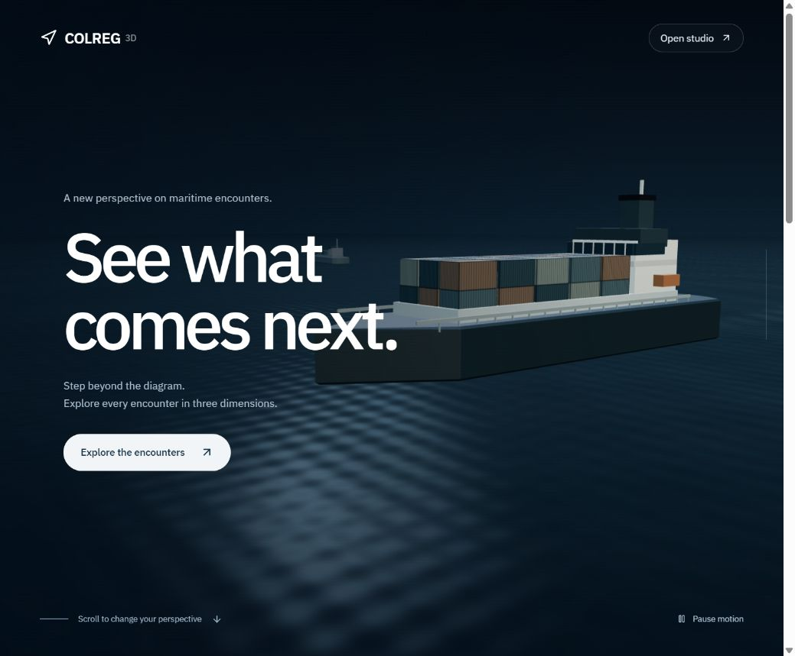
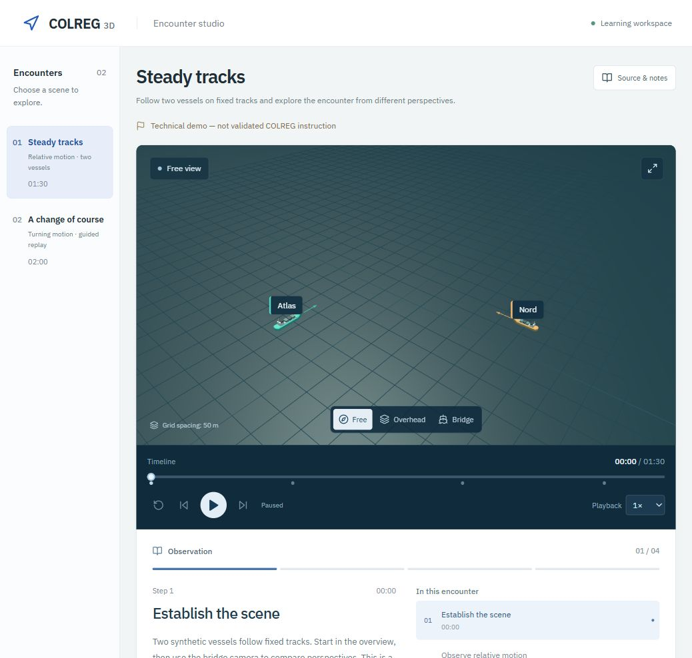

# COLREG 3D

[](https://github.com/emirhantunc01/colreg/actions/workflows/ci.yml)

An English-language web application for guided, three-dimensional maritime encounter studies. A scroll-driven cinematic opening leads into a scenario player with multiple camera views and step-by-step observations.



> **Prototype:** the included scenarios are synthetic technical demonstrations, not validated COLREG instruction. Source-based lessons will be added after the reference material and maritime review are available.

## Run locally

Use Node.js **24 or newer** and npm. `.nvmrc` selects Node 24 for CI and local version managers.

```sh
git clone https://github.com/emirhantunc01/colreg.git
cd colreg
npm ci
npm run dev
```

Open the URL printed by Vite, normally `http://127.0.0.1:5173/`. The development server binds to the local computer only. Stop it with Ctrl+C.

- `/` opens the cinematic introduction. Scroll through the photographic opening.
- `/#studio` opens the encounter player directly.
- **Replay opening** returns to the introduction.

No API keys, accounts, environment variables, backend or database are required.

## Encounter player



- Two file-based demonstration scenarios: steady tracks and an authored course change.
- Play/pause, restart, five-second jumps, scrubbing and 0.5×/1×/2× playback.
- Interruptible transitions between orbit, overhead and selected-vessel bridge cameras, plus optional Auto orbit.
- Optional vessel names, heading arrows and movement tracks.
- Timestamped observations and source/assumption notes.
- Deterministic motion: the same timestamp always produces the same vessel pose.
- Procedural vessels with optional Blender GLB replacements.

Desktop and tablet browsers with WebGL are the primary target. Narrow screens stack the panels. The opening respects reduced-motion preferences, supports pausing ambient motion and provides a fallback when 3D graphics are unavailable. Fonts load from Google Fonts with system fallbacks.

## Development checks

```sh
npm run typecheck
npm test
npm run build
npm run preview
```

GitHub Actions runs a locked dependency installation, TypeScript check, tests and production build on pushes to `main` and pull requests. Production output is generated in `dist/`; it is not committed. Serve the build over HTTP rather than opening it with `file://`. This repository does not automatically deploy a website.

## Project structure

| Location            | Purpose                                                              |
| ------------------- | -------------------------------------------------------------------- |
| `src/engine.ts`     | Scenario/library validation, interpolation and coordinate conversion |
| `src/Scene.tsx`     | Encounter rendering, procedural vessels and camera views             |
| `src/Cinematic.tsx` | GSAP opening with responsive licensed photography                    |
| `src/main.tsx`      | Library, transport controls, observations and source notes           |
| `public/scenarios/` | Scenario index and JSON definitions                                  |
| `content/`          | Book-processing index and extraction templates                       |
| `docs/`             | Authoring, design and verification notes                             |

## Adding educational content

Follow [the authoring guide](docs/AUTHORING.md). Keep original PDFs in `content/sources/`, which is ignored by Git except for its README. Record source pages and figures, separate animation assumptions from book facts, compare each extraction with the original and obtain maritime expert review before marking educational content reviewed. The application does not ingest PDFs automatically.

Additional notes: [project status](PROJECT_STATUS.md), [cinematic behavior](docs/CINEMATIC.md), [interface direction](docs/INTERFACE.md), [verification](docs/VERIFICATION.md).

## Current limits

This is authored visualization, not a hydrodynamic or live-navigation simulator. It does not adjudicate collisions, generate avoidance decisions or replace official rules and professional instruction. The opening uses a real, licensed ship photograph; the interactive studio uses procedural 3D vessels. See [photo credits](docs/ASSETS.md). The initial JavaScript bundle includes Three.js and GSAP; the production build currently reports a non-blocking bundle-size warning.
