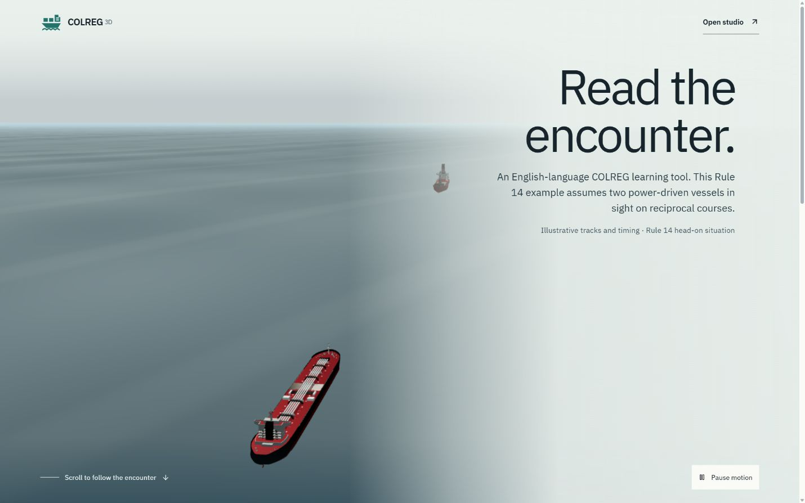
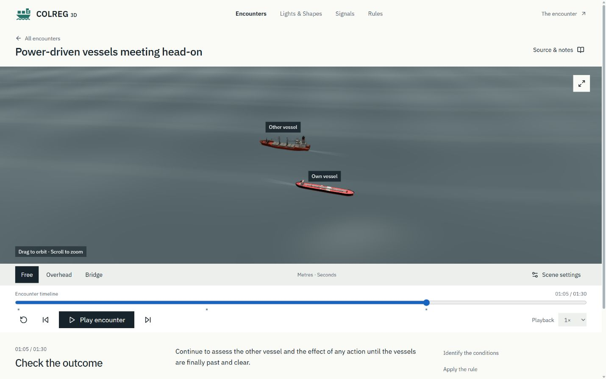

# COLREG 3D

[](https://github.com/emirhantunc01/colreg/actions/workflows/ci.yml)

An English-language web application for guided, three-dimensional maritime encounter studies. A scroll-driven cinematic opening leads into a scenario player with multiple camera views and step-by-step observations.



> Source-linked learning edition: all 41 rules and four annexes from the supplied Turkish PDF, 36 authored encounter scenes, and recognition/signal laboratories. English explanations and animated timings, distances and model dimensions are educational reconstructions. Two original technical demos remain available separately.

## Run locally

Use Node.js **24 or newer** and npm. `.nvmrc` selects Node 24 for CI and local version managers.

```sh
git clone https://github.com/emirhantunc01/colreg.git
cd colreg
npm ci
npm run dev
```

Open the URL printed by Vite, normally `http://127.0.0.1:5173/`. The development server binds to the local computer only. Stop it with Ctrl+C.

- `/` opens the cinematic introduction. Scroll through the authored 3D encounter.
- `/#studio` opens the encounter player directly.
- **The encounter** returns to the introduction.

No API keys, accounts, environment variables, backend or database are required.

## Encounter player



- 36 source-linked encounters plus two original technical demos, searchable rules with original page previews, directional lights/day shapes and opt-in signal playback.
- Play/pause, restart, five-second jumps, scrubbing and 0.5×/1×/2× playback.
- Interruptible transitions between orbit, overhead and selected-vessel bridge cameras, plus optional Auto orbit.
- Optional vessel names, heading arrows and movement tracks.
- Timestamped observations and source/assumption notes.
- Deterministic motion: the same timestamp always produces the same vessel pose.
- Licensed cargo and tanker GLBs with desktop/mobile derivatives, plus other legacy and procedural vessels.

Desktop and tablet browsers with WebGL are the primary target. Narrow screens stack the panels. The opening respects reduced-motion preferences, supports pausing ambient motion and provides a fallback when 3D graphics are unavailable. Fonts load from Google Fonts with system fallbacks.

## Development checks

```sh
npm run typecheck
npm test
npm run build
npm run preview
```

GitHub Actions runs a locked dependency installation, TypeScript check, tests and production build on pushes to `main` and pull requests. Production output is generated in `dist/`; it is not committed. Serve the build over HTTP rather than opening it with `file://`. This repository does not automatically deploy a website.

## Project structure

| Location            | Purpose                                                              |
| ------------------- | -------------------------------------------------------------------- |
| `src/engine.ts`     | Scenario/library validation, interpolation and coordinate conversion |
| `src/Scene.tsx`     | Encounter rendering, procedural vessels and camera views             |
| `src/Cinematic.tsx` | Scroll-led opening using the authored 3D head-on encounter           |
| `src/main.tsx`      | Library, transport controls, observations and source notes           |
| `public/scenarios/` | Scenario index and JSON definitions                                  |
| `content/`          | Book-processing index and extraction templates                       |
| `docs/`             | Authoring, design and verification notes                             |

## Adding educational content

Follow [the authoring guide](docs/AUTHORING.md) and [source provenance notes](docs/CONTENT_SOURCE.md). The supplied source is preserved at `public/content/colreg-source.pdf` and loads only when opened. Record page references and distinguish authored movement assumptions from source requirements. Source-linked lessons can be displayed without an expert-approval gate; the `reviewed` status is reserved for a documented review. The application does not ingest PDFs through its UI.

Additional notes: [project status](PROJECT_STATUS.md), [cinematic behavior](docs/CINEMATIC.md), [interface direction](docs/INTERFACE.md), [verification](docs/VERIFICATION.md).

## Licensed ship models

The opening and matching encounters use the user-supplied Cargo ship by hungry_drifter
and Tanker Ship by KoreanNavy, both CC BY 4.0. Credits are visible in the application.
The optimized pair is 5.85 MB on desktop and 3.00 MB on mobile (decimal units).
Original ZIPs and Blender sources stay outside the public build. See
[provenance](docs/ASSET_PROVENANCE.md) and the
[reproducible Blender/optimization workflow](assets/source-models/README.md).

## Current limits

This is authored visualization, not a hydrodynamic or live-navigation simulator. It does not adjudicate collisions, generate avoidance decisions or replace official rules and professional instruction. Model draughts and teaching dimensions are illustrative. Physical-phone FPS remains unverified. The initial JavaScript bundle includes Three.js and GSAP; the production build currently reports a non-blocking bundle-size warning.
